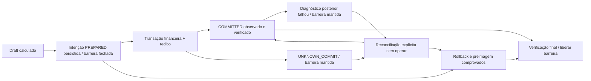

# ATLAS — INFRA-1.2.2: commit incerto e reconciliação segura

Referência da sessão: 12/11/2026, UTC.
**PAPER_ONLY / SECURITY_FIRST / LOCAL_TESTS_ONLY / NO_PRODUCTION_DEPLOY.**
Repositório exclusivo: `oliveirasamuel03-jpg/robo-investimentos`.

## Resultado e rastreabilidade

Implementação e homologação local realizadas, para auditoria posterior do Atlas.
**Esta entrega não aprova testes de 72 horas**, Web/Worker prolongados, produção,
ordens reais ou exactly-once externo.

- HEAD inicial local e referência remota conferidos:
  `fc5931254c85d1b36591818fcafa0e204e37c5b3`.
- Base: `atlas/infra-1-2-1-parada-segura`.
- Branch exclusiva: `atlas/infra-1-2-2-commit-incerto`.
- Implementação/testes:
  [`cac10c006d45a71cf2b29f9df07096cccbf7a38f`](https://github.com/oliveirasamuel03-jpg/robo-investimentos/commit/cac10c006d45a71cf2b29f9df07096cccbf7a38f).
- Feedback explícito de rollback comprovado: `1cf19caa10664239a02363eb10c0dbda4ea25610`.
- O commit final é o que introduz este relatório/evidências; seu SHA pode ser
  obtido por `git log -1 --format='%H %s' -- docs/retomada/ATLAS_INFRA_1_2_2_COMMIT_INCERTO.md`
  e é fornecido também na entrega final.
- Sem alterações da main, PR, merge, deploy, Railway ou banco antigo.

## Falha original reproduzida

O teste `test_legacy_fc593_response_loss_reproduction` extrai a base com
`git archive`, em diretório temporário, e executa seu código contra um PostgreSQL
local descartável. Injeta uma exceção Python depois da saída bem-sucedida da
unidade transacional. Uma conexão independente observa **um trade realmente
confirmado no servidor**, apesar da exceção genérica recebida pelo chamador.
A base admite um segundo ciclo financeiro; com fechamento sintético, o servidor
passa a conter BUY e SELL. Não havia barreira persistente para o resultado incerto.

[Reprodução observada](evidencias/infra122-legacy-response-loss.json).
A exceção de resposta perdida é **simulada em Python**. O COMMIT e os registros
consultados são reais no PostgreSQL local. Não se afirma que pacotes de rede
foram descartados nem que se provocou uma falha real de infraestrutura.

A injeção nova na fronteira do COMMIT distingue a fase em que a resposta ainda
não foi reconhecida pelo cliente de uma falha de cleanup/diagnóstico depois de
uma resposta positiva conhecida. Essas duas situações não recebem o mesmo resultado.

## Auditoria dos caminhos de erro

| Caminho | Risco anterior | Tratamento atual |
|---|---|---|
| Saída de `persistence_transaction`/COMMIT | Exceção genérica não distinguia rollback e resposta perdida. | Witness da fase do cliente; intenção durável anterior e recibo no mesmo commit financeiro. |
| `run_paper_cycle`: relatório, trades/equity de apresentação | Operação já gravada podia terminar como erro genérico. | POST_COMMIT_DIAGNOSTIC_FAILURE com identidade e confirmação preservadas. |
| `run_trader_cycle`: feed/contexto, relatório, risco e leituras finais | Exceção após commit chegava ao worker como falha do ciclo inteiro. | Separação explícita do resultado financeiro e da atividade posterior. |
| Worker: heartbeat, log, saúde e manutenção depois do retorno | Novo loop não tinha uma barreira durável para a intenção anterior. | Consulta da barreira antes de operar; tratamento específico de desconhecido e de falha posterior. |
| START/reset/configurações | Reset ou início não conheciam resultado financeiro pendente. | START e resets rejeitados; heartbeat e STOP preservam a barreira. Escritas genéricas protegidas. |
| Streamlit | Booleano ou exceção isolados não eram prova suficiente. | Prioridade ao outcome explícito, mensagens distintas e botão de reconciliação sem execução financeira. |

A INFRA-1.2.1 continua protegendo parada, versão de estado, risco e broker antes
da publicação. O novo protocolo não coloca aquisição de mercado sob transação
longa e não altera os cálculos da estratégia.

## Arquitetura e estados do protocolo

Utiliza as tabelas existentes `app_state` e `app_rows`, sem coluna, índice,
extensão ou migração de schema nova. Novos namespaces em `app_state`:

- `paper_commit_control`: identidade da intenção pendente, razão da barreira e
  último resultado verificado.
- `paper_cycle_receipt:<cycle_id>`: plano por hashes, preimagem, manifesto posterior,
  backend, identidade, estado e trilha de verificação do ciclo.

O recibo não é outro ledger: guarda identidades, contagens e hashes dos dados
financeiros canônicos. Saldo, posições, trades e relatórios continuam nos
namespaces existentes. O estado PAPER recebe `last_cycle_id`; eventos e relatórios
PostgreSQL novos recebem `cycle_id` no JSON. O ID não modifica entrada, saída ou
valor financeiro. Recibos permanecem preservados; não há limpeza automática.



| Resultado financeiro | Evidência exigida |
|---|---|
| COMMITTED | Recibo do ciclo e seus dados observados no PostgreSQL, plano de eventos/estado compatível, verificação sob barreira de escritores. Resposta positiva conhecida também é preservada se diagnóstico posterior falhar. |
| NOT_COMMITTED | Rollback/ausência da unidade comprovados por recibo PREPARED/NOT_COMMITTED e preimagem financeira exata, lidos sob a barreira depois do término da transação anterior. Exceção isolada não é prova. |
| UNKNOWN_COMMIT | Resposta não determinada, leitura impossível, recibo ausente/inválido, plano não comprovado ou divergência. Não autoriza repetição nem liberação por timeout. |
| POST_COMMIT_DIAGNOSTIC_FAILURE | Commit positivo conhecido, mas verificação/persistência diagnóstica, apresentação ou etapa posterior falhou. Não é rollback; não deve induzir retry financeiro. |

`PREPARED` é estado interno da intenção, não aprovação de operação. O witness
registra fases NOT_STARTED/BODY/COMMIT_ATTEMPTED/COMMITTED; fica em RAM apenas
para classificar a resposta do cliente. **A barreira não depende desse witness**:
foi gravada antes da tentativa financeira e sobrevive ao processo.

No backend de arquivos, o resultado normal é **LOCAL_ONLY**, e não declaração de
COMMIT PostgreSQL. Não se afirma rollback atômico entre arquivos. Uma tentativa
incerta local permanece bloqueada quando não há prova suficiente. Execução com
`APP_ENV=production` e sem PostgreSQL é recusada. Esse fallback existe para os
ensaios e compatibilidade offline, sem liberação operacional prolongada.

## Ordem de confirmação e bloqueio

1. Antes do feed e novamente antes da unidade financeira, ler a barreira. Falha
   de leitura/conexão interrompe execução; não existe fallback para um banco/local
   vazio nem retry financeiro automático.
2. Fazer preflight sob o lock existente: STOP, PAPER, risco, revisão operacional
   e CAS. Falhas anteriores à intenção não executam a unidade financeira.
3. Persistir PREPARED e a barreira em transação independente; verificar sua
   identidade antes de começar a transação financeira.
4. Na transação financeira, revalidar controles, rejeitar identidades repetidas,
   gravar saldo/posições, trades, relatórios, espelho da plataforma e recibo.
   Todos pertencem ao mesmo COMMIT PostgreSQL.
5. Se a resposta do COMMIT for indeterminada, lançar UNKNOWN_COMMIT e **não tentar
   reconciliar/liberar automaticamente essa tentativa**. O próximo ciclo e um
   processo reiniciado encontram a intenção pendente antes de buscar feed.
6. Para falha de BODY anterior ao envio de COMMIT, só atribuir NOT_COMMITTED após
   releitura cercada e comparação exata com a preimagem. Se isso não puder ser
   provado, manter UNKNOWN e a barreira.
7. Com resposta positiva, verificar dados reais. A barreira permanece fechada
   até concluir a apresentação essencial e a verificação final. Falha posterior
   recebe POST_COMMIT_DIAGNOSTIC_FAILURE.
8. Reconciliação explícita lê e registra evidências; nunca recalcula BUY/SELL,
   reenvia intenção, apaga registro ou deduplica histórico.

A perda de confirmação ao registrar/liberar a própria reconciliação é separada
do resultado financeiro já observado: `resolution_recorded=False` não transforma
um COMMITTED verificado em rollback ou em autorização para repetir a operação.
O chamador recebe falha diagnóstica e deve verificar novamente o estado da barreira.

## Evidências de reconciliação e integridade financeira

A reconciliação adquire `atlas:persistence-unit`, a mesma barreira dos escritores
cooperantes. Enquanto uma transação anterior estiver ativa, ela não pode provar
sua ausência. São comparados:

- Identidade do ciclo no gate, recibo e `paper_state.last_cycle_id`.
- Hash esperado do draft financeiro e hash atual do estado PAPER.
- Hash/contagem e sequência das linhas em `paper_trades`, `trader_orders.csv` e
  `trade_reports.csv`; JSON válido e valores finitos continuam obrigatórios.
- Hashes do plano versus eventos/relatórios realmente persistidos daquele ciclo,
  retirando apenas o metadado `cycle_id` para comparar o conteúdo planejado.
- SELL e relatório fechado: referência, ativo, quantidade, preço de saída, gross
  e PnL correspondentes ao contrato existente.
- No ciclo trader, saldo/PnL e quantidades das posições TRADER espelhadas versus
  o estado PAPER. Outros módulos de posição permanecem preservados.
- Diagnóstico financeiro existente: saldo, patrimônio, posições, referências,
  duplicações, último snapshot e relação com eventos disponíveis.

A verificação não presume que histórico limitado/legado seja completo e não
reconstrói nem corrige o histórico antigo. O modo PAPER isolado identifica no
recibo se existe finalizador de espelho; o vínculo lógico com plataforma é
exigido no fluxo trader, que é o utilizado pelo worker. Divergência impede a
liberação, mesmo que o servidor tenha confirmado a transação.

Um recibo inexistente não é criado silenciosamente durante a reconciliação.
Identidades de recibo são UUIDs validados antes de formar caminhos locais.
Escritas genéricas não podem remover a barreira/recibo; escritas financeiras
comuns e retenção dos namespaces protegidos são recusadas enquanto pendentes.
O protocolo pressupõe escritores desta versão; SQL privilegiado/versões antigas
não são uma fronteira de segurança resolvida por hashes.

## Reinício, STOP, START e reset

O teste com intérprete novo encontra UNKNOWN persistido e recusa ciclo sem feed
ou novo trade. Recuperar a conexão por si só não libera: o gate continua fechado
até evidência suficiente e reconciliação explícita.

STOP usa seu protocolo separado e permanece solicitável durante UNKNOWN. Com
banco acessível, solicitação e ACK persistem sem alterar a intenção financeira.
Com banco inacessível, não é possível confirmar STOP: o recibo continua
UNCONFIRMED, como na INFRA-1.2.1. UNKNOWN financeiro não é STOP do operador.
Heartbeat não remove a barreira. START e resets comuns não a contornam. Fase
`cycle_activity=FAILED` não prova rollback; a autoridade sobre resultado financeiro
é o recibo/outcome. Nenhum timeout autoriza retomar operações.

As telas mostram resultado desconhecido/reconciliação necessária, divergência,
falha posterior e confirmação verificada com mensagens diferentes. O botão
**Verificar reconciliação (sem operar)** não chama o motor e continua protegido
pela autorização administrativa existente. Não são exibidas credenciais ou
mensagens brutas de conexão. Os AppTests exercitam as duas telas, reconciliação
sem prova e STOP mantendo a barreira financeira.

## Avaliação de idempotência e compatibilidade

Foi avaliada a [proposta INFRA-1.2.1](ATLAS_INFRA_1_2_1_IDEMPOTENCIA_PROPOSTA.md).
A identidade persistente antes da transação era necessária; pôde ser implementada
com a PK de namespace existente. Não foi necessário DDL novo nesta fase.

A barreira serializa intenções pendentes; validação rejeita duplicação de
`(trade_id, side)` e de relatório fechado nos eventos novos cobertos. Não há
índice único de evento ou chave de requisição reutilizável por cliente externo.
Uma intenção nova recebe UUID novo: isso **não prova exactly-once para pedidos
externos arbitrariamente repetidos**. A proposta de coluna/índice parcial e recibo
de requisição externa continua futura, sem migração local/remota aplicada.

Histórico antigo permanece com IDs/metadados originais. Não há backfill,
reidentificação, exclusão ou deduplicação automática. Todos os escritores precisam
ser atualizados de forma coordenada antes de qualquer homologação operacional.

## Testes e resultados reais

| Execução final | Coletados | Aprovados | Falhas/erros | Skips | Warnings | Tempo |
|---|---:|---:|---:|---:|---:|---:|
| Offline completo | 566 | 500 | 0 | 66 | 99 | 34,98s |
| PostgreSQL 18.6 local | 66 | 66 | 0 | 0 | 43 | 74,57s |
| PostgreSQL 16.15 Alpine local | 66 | 66 | 0 | 0 | 43 | 77,81s |

**566 casos distintos**: 526 anteriores + 20 novos offline + 20 novos PostgreSQL.
Os 66 skips offline são integração, executada separadamente nas duas versões;
não foram somados como aprovados offline. Nenhum desses casos ficou pendente.
Nenhum teste anterior foi removido ou teve seu assert relaxado. A referência
480/46/46 permanece preservada; reexecuções não foram somadas como casos distintos.

[Offline](evidencias/infra122-offline.txt), [PG18](evidencias/infra122-postgres18.txt),
[PG16](evidencias/infra122-postgres16.txt), com XML de mesmo prefixo.
[Checks](evidencias/infra122-checks.txt): compileall, pip check e diff --check com
exit code 0. Warnings de datetime/pandas foram preservados. O guard offline
bloqueou 124 tentativas de rede/processo. Os logs TXT tiveram apenas espaços
finais/linhas vazias finais normalizados para higiene Git.

Desenvolvimento: a primeira execução dos novos testes locais teve 2 failed e
12 passed. Identificou START sem consulta da barreira e import de módulo que
mantinha classe antiga no isolamento de testes; ambos foram corrigidos no código,
sem enfraquecer os testes. [Log preservado](evidencias/infra122-development-failures.txt).
As integrações intermediárias de 61 e 65 casos passaram; os casos adicionais
cobrem, entre outros, bookkeeping, vínculo de plataforma e confirmação positiva
seguida de falha. O ajuste final de feedback distingue também NOT_COMMITTED comprovado de erro
genérico na UI/worker, sem alterar a unidade financeira. As execuções finais
acima refletem os arquivos entregues.

### Matriz obrigatória

| Cenário | Evidência |
|---|---|
| 1. Antes de enviar COMMIT | Hook anterior ao envio levanta erro; rollback real e preimagem comprovam NOT_COMMITTED. |
| 2. Durante tentativa | Exceção simulada na fronteira de COMMIT, cliente em COMMIT_ATTEMPTED; UNKNOWN mantido até verificar ausência real no servidor. |
| 3. Servidor confirmou/resposta perdida | COMMIT real seguido de exceção Python simulada antes do reconhecimento pelo witness; conexão independente lê recibo COMMITTED e trade. |
| 4. Falha posterior | Falha em relatório PAPER, diagnóstico trader, cleanup após resposta positiva e handler posterior do worker: POST_COMMIT_DIAGNOSTIC_FAILURE. |
| 5–6. Reinício/segundo ciclo | Processo novo e segundo ciclo encontram barreira; nenhum retry financeiro. |
| 7–8. Recuperação/reconciliação confirmada | Falha de conexão injetada mantém bloqueio; conexão recuperada exige reconciliação explícita e plano/manifesto correspondentes. |
| 9–10. Prova insuficiente/divergência | Recibo inválido, saldo/posição alterados, trade/relatório extra e finalizador de espelho defeituoso mantêm bloqueio. |
| 11–12. STOP/START/reset | STOP e ACK independentes; START, resets e escrita genérica não removem intenção pendente. |
| 13–14. Duplicação/relatórios | Repetições BUY/SELL e relatório fechado rejeitadas; rollback de SELL/relatório e retry explícito continuam cobertos pela suíte anterior. |
| 15. Falha do worker | Novo processo recusa operar UNKNOWN; handler posterior a commit conhecido preserva confirmação e recoloca barreira. Não se iniciou loop contínuo. |

A infraestrutura PostgreSQL é real; as falhas de comunicação/conexão deste
protocolo são **injeções determinísticas**, não uma campanha de falhas reais de
rede. A suíte anterior mantém também interrupção real de backend/reconexão.

## Equivalência financeira e PAPER

[Equivalência](evidencias/infra122-strategy-equivalence.json): cinco comparações
exatas com a base fc593125 passaram para sinais, estado financeiro, alocação BUY,
SELL, repetição e quantidade de relatórios, com feed/relógio/IDs sintéticos.
Exclui-se apenas o novo campo de recibo `cycle_id` dos eventos comparados;
nenhum valor financeiro ou sinal é descartado para fazer a comparação passar.
Warnings de ambas as execuções constam no artefato. É prova desses cenários,
não equivalência universal em todos os mercados.

BROKER_MODE e BROKER_PROVIDER foram impostos como `paper`. Guardas de STOP,
broker, risco e revisão operacional anteriores passaram novamente. Não se
alteraram capital, ticket, score, thresholds, min_signal_score,
max_open_positions, provider de mercado, critérios de entrada/saída ou flags.
SHADOW_ONLY/STUDY_ONLY/DIAGNOSTIC_ONLY/PLANNING_ONLY continuam sem autoridade de
negociação. Diagnóstico financeiro é usado para verificar/liberar uma barreira
de integridade, não para gerar sinal ou mudar a estratégia. Sem FASE 2.6C ou
ordens reais.

## PostgreSQL local e reprodução

18.6 e 16.15 foram usados em contêineres próprios, tmpfs, porta efêmera somente
127.0.0.1, banco novo por teste e senha aleatória sintética. Digests constam nos
logs. Runners descartam DATABASE_URL/segredos herdados e recusam `.env` local.
As imagens de teste foram usadas sequencialmente para evitar ENOSPC; só recursos
criados nesta sessão foram removidos. Nenhum contêiner de homologação permaneceu.
Nenhum banco remoto, dado pessoal real ou PostgreSQL antigo foi acessado.

```bash
.venv/bin/python scripts/test_offline.py -q
# Imagens oficiais previamente disponíveis, uma versão por vez.
.venv/bin/python scripts/test_infra12_postgres.py --version 18
.venv/bin/python scripts/test_infra12_postgres.py --version 16 --alpine
.venv/bin/python scripts/check_infra122_strategy_equivalence.py
.venv/bin/python -m compileall -q core engines workers pages paper_trading_engine.py scripts tests
.venv/bin/python -m pip check
git diff --check
```

A reprodução da base ocorre no próprio `tests/test_infra122_postgres.py`, pelo
runner descartável. Não substituir DSN sintético por banco remoto.

## Arquivos alterados

- Produção: `core/commit_protocol.py`, `core/persistence.py`, `core/state_store.py`,
  `core/stop_control.py`, `core/ui_mutations.py`, `paper_trading_engine.py`,
  `engines/trader_engine.py`, `workers/trader_worker.py`, `pages/1_Trader.py`,
  `pages/4_Controle_do_Bot.py`.
- Homologação: `scripts/test_infra12_postgres.py`,
  `scripts/check_infra122_strategy_equivalence.py`, `tests/conftest.py`,
  `tests/test_commit_protocol.py`, `tests/test_infra122_postgres.py`.
- Este relatório e arquivos `docs/retomada/evidencias/infra122-*`.

## Riscos residuais e critérios de liberação

- **Alta:** hashes, locks e guards pressupõem banco/configuração de origem
  preservados e escritores cooperantes desta versão. SQL privilegiado, código
  antigo, troca de banco, perda de volume ou restauração sem recibos não são
  resolvidos por este protocolo. Não misturar versões nem fontes de dados.
- **Alta:** arquivos locais não oferecem transação multi-arquivo ou prova de
  COMMIT PostgreSQL. Permanecem inadequados para homologação operacional longa.
- **Média:** não há índice único de evento nem idempotência de requisição externa;
  aprovação de cliente/worker prolongado exige projeto complementar.
- **Média:** manifestos e verificação de histórico têm custo proporcional ao
  tamanho dos namespaces e mantêm o lock durante a comparação. Validar latência,
  volume e efeito no STOP antes de operação prolongada; testes pequenos não são
  benchmark de capacidade.
- **Média:** confirmação de registro/liberação da reconciliação pode se perder;
  distinguir isso do COMMIT financeiro já observado. Falha de registro deve
  continuar visível e não disparar reexecução financeira.
- **Média:** reconciliar a identidade pendente, não interpretar um manifesto
  histórico como snapshot atual após outros ciclos/retention. Os recibos preservam
  a evidência histórica, mas a liberação automática exige comparação com a unidade
  pendente e estado atual sob a barreira.

Liberar a barreira apenas com recibo/identidade, plano, estado e namespaces
compatíveis ou ausência da unidade comprovada. Falha de leitura, timeout,
divergência ou recibo incompleto não liberam. Não há botão de force-unlock,
exclusão compensatória ou deduplicação de histórico. O banco antigo não foi
recuperado e sua condição permanece desconhecida nesta fase.

## Rollback e próxima auditoria Atlas

Rollback deve manter escritores suspensos e preservar gate/recibos/ledger em
backup coerente. Não reativar fc593125 enquanto existir intenção pendente: essa
versão não aplica a nova barreira. Não apagar metadados para fazer o robô voltar
a operar. Não há DDL novo a desfazer; nenhum rollback remoto foi executado.

Antes de futura homologação de 72 horas, Atlas deverá auditar os limites de
idempotência externa, transição coordenada de versões, backups incluindo recibos,
falhas reais de comunicação no COMMIT, recuperação/failover, tamanho dos
manifestos, contenção de STOP e confirmação manual de liberações. Também deverá
verificar previews/autodeploy antes de qualquer PR ou publicação operacional.
**Não há autorização de 72 horas nesta entrega; depende de auditoria posterior.**

Nenhum PR, merge, deploy, restart Railway, alteração remota de variável,
provisionamento, compra ou upgrade foi executado. Commits somente na branch nova,
com `[skip ci]`; nenhum novo workflow de deploy. Nenhum custo externo novo contratado.
