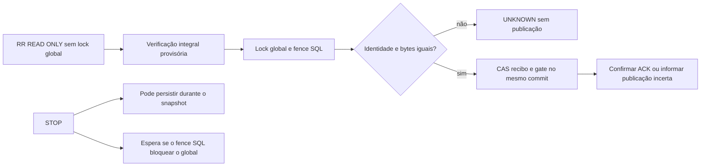

# ATLAS — INFRA-1.2.5: snapshots consistentes e revisão transacional

12/11/2026 UTC. **PAPER_ONLY / SECURITY_FIRST / COST_CONTROLLED /
LOCAL_TESTS_ONLY / NO_PRODUCTION_DEPLOY.**
Repositório exclusivo `oliveirasamuel03-jpg/robo-investimentos`.

## 1. Resultado e rastreabilidade

HEAD remoto consultado antes de agir: `atlas/infra-1-2-4-contencao-stop` =
`64ca64f25020983546bfbce8427e7adac437ddf1`, idêntico ao HEAD local limpo.
Branch nova: `atlas/infra-1-2-5-snapshot-transacional`.
Commit do protótipo/testes: [`91572f7bb3c4ab3b9b5fc80e05ccbbb5e9bbc664`](https://github.com/oliveirasamuel03-jpg/robo-investimentos/commit/91572f7bb3c4ab3b9b5fc80e05ccbbb5e9bbc664).
Regressão adicional MVCC: [`c5349161181c692f91d3f637cde653c4081f49e1`](https://github.com/oliveirasamuel03-jpg/robo-investimentos/commit/c5349161181c692f91d3f637cde653c4081f49e1).
Commit final é o que introduz este relatório e suas evidências, identificável por
`git log -1 --format='%H %s' -- docs/retomada/ATLAS_INFRA_1_2_5_SNAPSHOT_TRANSACIONAL.md`;
o SHA concreto também acompanha a entrega final.

**Otimização NÃO INTEGRADA. Produto atual preservado.** O protótipo reduz o
trabalho de reconciliação sob lock em condições controladas, mas a publicação
com fence de tabelas pode bloquear STOP por aproximadamente cinco segundos.
Também não otimiza a unidade financeira/begin_intent que continuam fazendo
manifestos integrais sob lock. Não satisfaz as condições conjuntas de integração.
Não há autorização para 72 horas ou qualquer operação prolongada.

| Termo | Situação nesta entrega |
|---|---|
| PROPOSTA | Revisões por namespace, raízes incrementais, contratos de escritor e migração futura |
| PROTÓTIPO | Snapshot RR READ ONLY + verificador existente + comparação exata antes de publicar metadados |
| IMPLEMENTADO | Scripts isolados, DDL de estudo local, testes, instrumentação e documentação |
| TESTADO | Cenários e versões com resultados reais registrados abaixo |
| APROVADO | Nenhuma integração operacional ou janela de 72 horas aprovada |

## 2. Diagnóstico e baseline preservada

Auditados commit_protocol, persistence, stop_control, state_store, retention,
trader/PAPER engines e worker. [Mapa de escritores](evidencias/infra125-audit-before.md).
As evidências INFRA-1.2.3/1.2.4 originais permanecem preservadas; resultados novos
dessas regressões recebem prefixo infra125-regression-*.

Na baseline, manifestos integrais são chamados em begin_intent e
record_unit_result, depois nas reconciliações positiva/intermediária e final.
No benchmark, a reconsulta explícita acrescenta mais uma: cinco manifestos por
ciclo. Cada um lê, decodifica e serializa/hash todo o histórico financeiro.
As checagens de duplicatas permanecem integrais quando existem candidatos.
O lock global também ordena STOP, heartbeat, UI, relatórios e manutenção.

A INFRA-1.2.4 reduziu a mediana, mas máximos de STOP/lock com 5.000 eventos
continuaram fora das metas. Aqui a referência current é o produto **sem qualquer
alteração**, executado novamente no mesmo harness da candidata.

## 3. Alternativas investigadas

| Alternativa | Conclusão |
|---|---|
| Revisão somente em APIs Python | Escritor antigo/SQL externo não participa; não prova integridade |
| Revisão com triggers transacionais | Captura DML normal e rollback; bypass privilegiado/reset de metadados invalidam a confiança |
| Manifesto incremental | Exige cadeia/raiz autenticada, sequência, cobertura de UPDATE/DELETE/movimentos e arquivo; não aplicado |
| Seleção por identidade | Útil para recibos, mas não substitui prova de ausência de adulteração em eventos antigos |
| Snapshot consistente sem rechecagem | Consistente no passado, não prova estado atual; reprovado como autorização de publicação |
| Snapshot + comparação exata | Preserva conteúdo/identidades; publicação necessita proteção contra escritores externos durante a comparação |
| Fence SQL de tabelas | Evita DML/phantoms externos no intervalo, mas amplia contenção e gera bloqueio de integração demonstrado |

Não foi aceita revisão/contagem/MAX(seq) como substituta de dados reais. Nenhum
cache entre ciclos ou estado em RAM libera uma intenção financeira.

## 4. Arquitetura candidata isolada

`scripts/prototypes/infra125_snapshot.py` não é importado pelo runtime. Construtor
exige runner descartável, usuário/banco sintéticos, porta local pertencente ao
runner, container etiquetado e BROKER_MODE/BROKER_PROVIDER=paper.

1. Abrir conexão própria REPEATABLE READ, READ ONLY, sem lock global de escritor.
2. Capturar estado PAPER, bot, gate, recibo selecionado e todas as linhas
   financeiras com seq/namespace/payload, ordenadas; guardar identidade do banco,
   cluster e instante de início do postmaster.
3. Executar o código **original** do verificador em globals privados, com leituras
   no mesmo snapshot e sink de gravação somente em memória. Não é uma segunda
   implementação independente do cálculo financeiro. O resultado é **provisório**, não é
   confirmação financeira atual nem de publicação dos metadados.
4. Plano e observações ficam em objeto privado imutável, vinculado à instância;
   não são exportados como autoridade e não sobrevivem como autorização no restart.
5. Em nova conexão, adquirir lock global e de namespace existentes, depois
   SHARE ROW EXCLUSIVE nas duas tabelas. Reconsultar identidade e dados crus.
6. Exigir igualdade **exata**, incluindo recibo/gate e JSON textual, não só hashes
   ou contagem. Se mudou, retornar UNKNOWN/blocked, sem retry automático.
7. Se igual, publicar apenas recibo e gate por CAS/guardas existentes na mesma
   transação. Nunca escreve saldo, posição, trade, relatório ou inicia ciclo.
   Falha do ACK dessa publicação não é rollback/retry da operação financeira.



A comparação protege contra alterações externas durante o fence. Não protege
contra adulteração futura por administrador após o commit nem promete auditoria
de um ataque ABA que restaure exatamente os bytes entre observações; o verificador
atual também não é um log imutável de todas as ações externas.

## 5. Revisão transacional e DDL exclusivamente local

`scripts/prototypes/infra125_revision_local.sql` cria tabela de revisões e triggers
somente em bancos sintéticos. Recusa banco/usuário fora do contrato e segunda
instalação. Não é carregado pela inicialização da aplicação e não foi migrado
para nenhum banco remoto. Registra INSERT/UPDATE/DELETE, mudança de namespace e
evento de TRUNCATE; o teste de TRUNCATE ocorre em savepoint desfeito, sem apagar
histórico persistido. Rollback também reverte os contadores.

Foi demonstrado bypass real de triggers, usando session_replication_role apenas
na conexão administrativa sintética: conteúdo alterado com revisão inalterada.
Uma otimização que reaproveitasse prova somente por revisão aceitaria esse estado.
Verificador integral e snapshot exato recusam. **Revisão isolada REJEITADA por perda
de cobertura.** Isso não afirma que qualquer papel de produção tenha tal privilégio;
mostra por que participação/ACLs de escritores não podem ser presumidas.

Migração futura, se proposta: parar escritores, backup verificado, auditoria
integral inicial e versão explícita de contrato. Instalar contador não valida
histórico preexistente. Preservar recibos atuais, testar escritores mistos e
permissões sem conceder administração ao app. Não há backfill, retenção de
recibos ou rollout remoto nesta fase. Contadores não viram outra fonte financeira.

## 6. Equivalência e corpus de corrupção

13 estados por versão comparados diretamente: íntegro (COMMITTED), JSON inválido,
valor alterado sem mudar contagem, exclusão antiga, inclusão indevida, troca de
seq/ordem, recibo adulterado, saldo, posição, trade/relatório duplicados e recibo
ausente/corrompido (UNKNOWN). Outcomes coincidem; verificadores não alteram os
registros financeiros deliberadamente adulterados. Não há reparo automático.

Os demais cenários obrigatórios estão nas suítes novas/anteriores: corrida entre
captura e publicação (valor/recibo/heartbeat/arquivo), snapshot durante STOP,
STOP durante commit, escritor SQL externo, dois publicadores, rollback,
resposta financeira perdida, novo intérprete, resposta de metadados perdida,
falha TCP na leitura, restart real, revisão bypass/rollback/movimento de namespace,
backup/restore válido e sem recibo, retenção real e diagnóstico/prova antiga A/B.

[Evidências de equivalência PG18](evidencias/infra125-equivalence-pg18.json),
[PG16](evidencias/infra125-equivalence-pg16.json);
[corridas PG18](evidencias/infra125-races-pg18.json),
[PG16](evidencias/infra125-races-pg16.json);
[recuperação PG18](evidencias/infra125-recovery-pg18.json),
[PG16](evidencias/infra125-recovery-pg16.json);
[backup PG18](evidencias/infra125-backup-pg18.json),
[PG16](evidencias/infra125-backup-pg16.json).

A reutilização do código original evita divergência de regras, mas não prova a
correção da nova ordem de transações. Por isso os testes adversariais intercalam
escritas entre snapshot e publicação, usam transações concorrentes, sockets reais,
restart e restauração. A cobertura comprovada é a dos cenários executados, não
uma prova universal de equivalência para qualquer escritor/falha futura.

Casos benignos podem ter resultado diferente: heartbeat/whitespace no recibo ou
STOP alteram os bytes observados e invalidam a prova antiga, mesmo sem divergência
financeira. A candidata falha conservadoramente; essa perda de disponibilidade
não foi escondida como equivalência operacional.

## 7. Concorrência, STOP e bloqueio de integração

PG18: baseline sob a transação externa = 19.7 ms; candidata falha com LockNotAvailable; STOP = **5043.5 ms**, status PERSISTED, persistido=True. Gate financeiro permanece fechado.

PG16: baseline sob a transação externa = 24.4 ms; candidata falha com LockNotAvailable; STOP = **5038.4 ms**, status PERSISTED, persistido=True. Gate financeiro permanece fechado.

Máximo instrumentado final no ensaio de carga: 2901.4 ms; máximo final no adversarial de tabelas: 5043.5 ms. Exploratório adversarial preservado: 5037.6 ms. Esses universos não foram agrupados em um P95.

Enquanto o snapshot READ ONLY calcula/verifica, STOP consegue persistir sem
esperar esse cálculo. A prova antiga, que viu outro controle, não pode liberar
a intenção; nova reconciliação explícita é necessária, sem reexecutar trades.
Na publicação, Events e pg_locks comprovam esperas de advisory/relation locks;
escritor SQL externo não consegue mudar as linhas dentro do fence.

Mas o fence de tabelas também espera transações em namespaces **não financeiros**.
Essa espera ocupa o lock global e atrasa STOP. lock_timeout continua 5 s; não foi
aumentado. O ensaio preserva a transação externa até a falha e não usa sleep
arbitrário como evidência. Não declarar STOP concluído quando o recibo não confirma.

## 8. UNKNOWN_COMMIT e comunicação real

Uma transação ainda aberta pode estar invisível ao snapshot MVCC. O resultado
interno da preparação é apenas provisório: não prova NOT_COMMITTED atual. Testes
adicionais mantêm a unidade financeira aberta, comprovam o publicador aguardando
o lock, e então confirmam COMMIT ou rollback. Após COMMIT a prova de ausência
antiga é recusada; só após rollback e igualdade atual é publicado NOT_COMMITTED.
Nenhuma repetição financeira é executada. Esses casos foram executados em rodada
dedicada nas duas versões, além da suíte completa anterior.

Perda real de resposta financeira: proxy loopback observa COMMIT no servidor e
retém a resposta; novo intérprete encontra gate fechado. STOP continua disponível.
A candidata só reconcilia explicitamente o resultado; total de BUY/SELL permanece
idêntico, sem retry financeiro.

Perda real da resposta do commit **de metadados** da candidata: aplicação informa
resolution_recorded=False/blocked, embora outra conexão observe a liberação no
servidor. Não transforma isso em NOT_COMMITTED financeiro. Releitura/reconciliação
explícita posterior não cria trade.

Corte real de socket durante a leitura do snapshot mantém UNKNOWN/gate. Falha
Python antes do commit de metadados é registrada como injeção Python e comprova
rollback desses metadados, não falha real de rede.

## 9. Recuperação e identidade

SIGKILL/restart real somente do PostgreSQL descartável próprio. Estado financeiro,
STOP e UNKNOWN permanecem. A prova antiga é recusada pela mudança do início do
postmaster, mesmo com captura financeira idêntica. Banco inacessível durante STOP
retorna UNCONFIRMED; verificação inacessível não libera gate. Nova verificação
explícita reconhece o commit anterior sem executar operação.

Não foi demonstrada recuperação física de host/disco/energia. Provas em RAM não
são backup e nunca substituem controles persistidos.

## 10. Backup/restore e recibos

Backups/restore sintéticos usam o procedimento local já existente, snapshot
consistente, pg_dump/pg_restore no container próprio, origem parada e destino em
quarentena STOP. Gate UNKNOWN e recibos atuais são preservados. Recibo ausente
continua UNKNOWN; nenhum restore libera operação incerta automaticamente.

Prova preparada para outra instância/banco não é aceita: instância privada e
OID/cluster/epoch são conferidos. Triggers locais de revisão também são
restaurados; seus contadores podem avançar pelas escritas de quarentena e não
são prova portátil de integridade. Não há reatribuição/deduplicação de recibos.
O banco antigo não foi acessado, recuperado ou alterado. O carimbo verificado do
plano vem do snapshot, em instante distinto do commit de publicação; um contrato
de auditoria operacional para essa separação não foi homologado.

## 11. Retenção e escritores antigos

Retenção real com gate ativo deve falhar e reverter o arquivo/runtime na mesma
transação; prova íntegra anterior continua utilizável. Depois de manutenção
confirmada que arquiva relatório, a captura antiga é invalidada. O verificador
atual também fica UNKNOWN para seu manifesto anterior, pois hashes abrangem
namespaces canônicos de runtime. Histórico continua no arquivo, sem deleção
para aprovar desempenho. Compatibilidade operacional com arquivos/épocas não foi
resolvida e impede integração.

Escritor antigo que usa DML normal aciona triggers locais; SQL privilegiado pode
contorná-los. O snapshot exato independe desses contadores, mas precisa do fence
SQL mais amplo. Proposta futura exige política de escritores, privilégios e
prova de cobertura completa, sem conceder privilégios administrativos ao app.
`pg_control_system()` no protótipo usa o papel administrativo da fixture; ACL de
aplicação compatível não foi homologada.

## 12. Método e condições de desempenho

Volumes 0/1.000/5.000 eventos PAPER, mais ordens e relatórios correspondentes,
sem redução de histórico. Dez repetições por implementação/volume/versão; 30 não
foram adotadas para limitar CPU, disco e duração. São 1 CPU/512 MiB por servidor,
tracemalloc/profiling iguais, fonte de mercado sintética e um BUY novo por cenário;
as demais tentativas mantêm a posição e não duplicam operações.

Escalonamento igual nos dois lados: unidade financeira já adquiriu lock; STOP
é enfileirado e sua espera é observada; commit financeiro conclui; STOP retorna;
só então o verificador posterior captura seus dados. A barreira de teste é fora
do lock e evita comparar ordens diferentes de eventos. **Não modela toda corrida
real**: os conflitos de STOP/snapshot sem essa barreira são testados separadamente
e são um limite da candidata, não uma aprovação disfarçada.

A rodada exploratória teve sobreposição da suíte offline e não é usada na
comparação final. Todas as amostras foram preservadas como exploratory, incluindo
máximos desfavoráveis; a comparação final foi refeita sem outra suíte concorrente.
Nenhuma suíte offline ocorreu em paralelo aos benchmarks usados na comparação
final. A última rodada offline, para coletar os casos MVCC adicionais, ocorreu
depois desses benchmarks.

| PG | Eventos | Implementação | n | STOP ms med/P95/máx | Lock financeiro ms med/P95/máx | ACK ms med/P95/máx | Reconciliação ms med/P95/máx | Metas |
|---|---:|---|---:|---|---|---|---|---|
| 18 | 0 | Atual | 10 | 247.9/281.3/281.3 | 186.5/217.5/217.5 | 106.3/130.9/130.9 | 40.9/48.8/48.8 | Dentro na amostra |
| 18 | 0 | Snapshot | 10 | 248.1/271.8/271.8 | 187.9/213.9/213.9 | 104.2/127.0/127.0 | 59.2/96.1/96.1 | Dentro na amostra |
| 18 | 1000 | Atual | 10 | 549.8/2111.3/2111.3 | 476.6/2015.0/2015.0 | 110.2/141.5/141.5 | 289.6/461.5/461.5 | BLOQUEADO |
| 18 | 1000 | Snapshot | 10 | 533.1/608.6/608.6 | 471.0/558.6/558.6 | 105.5/113.9/113.9 | 334.1/398.8/398.8 | Dentro na amostra |
| 18 | 5000 | Atual | 10 | 1684.7/2613.5/2613.5 | 1622.0/2380.6/2380.6 | 116.1/127.6/127.6 | 1352.2/1567.0/1567.0 | BLOQUEADO |
| 18 | 5000 | Snapshot | 10 | 1765.9/2223.6/2223.6 | 1689.0/2151.8/2151.8 | 111.6/144.1/144.1 | 1520.8/1772.5/1772.5 | BLOQUEADO |
| 16 | 0 | Atual | 10 | 258.0/308.4/308.4 | 196.9/230.5/230.5 | 116.7/134.1/134.1 | 39.5/70.0/70.0 | Dentro na amostra |
| 16 | 0 | Snapshot | 10 | 257.6/438.0/438.0 | 194.3/343.6/343.6 | 108.1/137.3/137.3 | 65.3/90.2/90.2 | Dentro na amostra |
| 16 | 1000 | Atual | 10 | 550.5/687.0/687.0 | 485.3/556.7/556.7 | 107.6/163.2/163.2 | 281.8/529.8/529.8 | Dentro na amostra |
| 16 | 1000 | Snapshot | 10 | 546.1/618.7/618.7 | 482.4/557.1/557.1 | 108.3/150.7/150.7 | 331.0/515.0/515.0 | Dentro na amostra |
| 16 | 5000 | Atual | 10 | 1814.3/2047.4/2047.4 | 1749.0/1976.0/1976.0 | 125.0/186.9/186.9 | 1372.7/2078.3/2078.3 | BLOQUEADO |
| 16 | 5000 | Snapshot | 10 | 1738.4/2901.4/2901.4 | 1673.2/2781.8/2781.8 | 119.3/205.0/205.0 | 1584.1/2749.5/2749.5 | BLOQUEADO |

| PG | Eventos | Implementação | Ciclo total ms med/P95/máx | Espera lock financeiro ms med/P95/máx | STOP COMMIT ACK ms med/P95/máx | COMMIT financeiro ACK ms med/P95/máx | Queries medianas execute/controle |
|---|---:|---|---|---|---|---|---:|
| 18 | 0 | Atual | 1463.0/1983.1/1983.1 | 0.6/1.1/1.1 | 216.4/247.5/247.5 | 1.0/3.6/3.6 | 225/80 |
| 18 | 0 | Snapshot | 1545.4/1752.5/1752.5 | 0.5/0.7/0.7 | 215.0/239.0/239.0 | 1.2/4.3/4.3 | 255/86 |
| 18 | 1000 | Atual | 2516.4/6804.7/6804.7 | 0.7/2.8/2.8 | 516.6/2066.1/2066.1 | 1.3/4.8/4.8 | 225/80 |
| 18 | 1000 | Snapshot | 2564.2/2802.0/2802.0 | 0.6/0.9/0.9 | 497.9/580.3/580.3 | 1.1/2.0/2.0 | 255/86 |
| 18 | 5000 | Atual | 6833.8/9316.1/9316.1 | 0.7/1.3/1.3 | 1649.7/2460.2/2460.2 | 1.5/2.2/2.2 | 225/80 |
| 18 | 5000 | Snapshot | 7593.7/8444.4/8444.4 | 0.7/2.0/2.0 | 1725.1/2182.5/2182.5 | 1.7/3.7/3.7 | 255/86 |
| 16 | 0 | Atual | 1526.8/1848.0/1848.0 | 0.7/1.1/1.1 | 224.7/263.1/263.1 | 1.3/1.7/1.7 | 225/80 |
| 16 | 0 | Snapshot | 1568.0/1822.8/1822.8 | 0.6/0.9/0.9 | 223.1/378.0/378.0 | 1.3/1.8/1.8 | 255/86 |
| 16 | 1000 | Atual | 2696.5/3926.1/3926.1 | 0.7/1.3/1.3 | 514.5/623.3/623.3 | 1.1/3.5/3.5 | 225/80 |
| 16 | 1000 | Snapshot | 2726.2/3248.7/3248.7 | 0.7/1.3/1.3 | 512.1/584.1/584.1 | 1.3/2.1/2.1 | 255/86 |
| 16 | 5000 | Atual | 7344.7/9733.4/9733.4 | 0.7/1.3/1.3 | 1779.2/2005.8/2005.8 | 1.6/2.1/2.1 | 225/80 |
| 16 | 5000 | Snapshot | 7421.0/11015.3/11015.3 | 0.8/2.1/2.1 | 1702.4/2838.0/2838.0 | 1.4/3.2/3.2 | 255/86 |

[Dados brutos PG18](evidencias/infra125-benchmark-pg18.json), [PG16](evidencias/infra125-benchmark-pg16.json).

P95 por nearest-rank, n=10: coincide com máximo e tem baixa resolução; não é SLA
de 72 horas. Não se descartam máximos como ruído. Instrumentação mede tempo do
cliente: espera de lock inclui ida/volta SQL; hold termina no ACK do COMMIT,
limite superior à liberação no servidor. Pais/filhos de profiling são inclusivos.
Contagens cobrem execute/cursor.execute e controles dos contextos de transação;
não contam instruções internas de funções do PostgreSQL, nem expõem parâmetros.

## 13. Profiling, memória e recibos

| PG | Eventos | Hold global worker mediana atual → snapshot ms | Verificação integral fora do lock mediana ms | Publicação hold med/máx ms | Recibos bytes após 10 atual/snapshot |
|---|---:|---|---:|---|---:|
| 18 | 0 | 438.4 → 421.6 | 35.5 | 10.8/22.4 | 15756/15756 |
| 18 | 1000 | 1329.3 → 901.9 | 264.9 | 22.2/31.5 | 15916/15916 |
| 18 | 5000 | 4934.5 → 3094.1 | 1347.6 | 71.6/93.3 | 15936/15936 |
| 16 | 0 | 476.1 → 421.2 | 38.2 | 11.6/43.5 | 15756/15756 |
| 16 | 1000 | 1356.7 → 921.7 | 272.5 | 24.1/38.4 | 15916/15916 |
| 16 | 5000 | 5275.6 → 3042.6 | 1332.2 | 69.2/152.8 | 15936/15936 |

Pico Python rastreado máximo: 23.12 MiB; RSS high-water máximo: 380.83 MiB. Perfis completos em benchmark-pg18/16: SQL, decode, hash, recibos, manifestos e sincronizações. Os campos inside/outside indicam o contexto na entrada do wrapper; não somar pais/filhos.

Perfis 5.000 eventos (totais inclusivos de 10 ciclos; calls/ms):

| PG | Implementação | Etapa/contexto | Chamadas | ms total |
|---|---|---|---:|---:|
| 18 | current | core.commit_protocol._hash:inside | 264 | 17826.7 |
| 18 | current | core.commit_protocol._receipt:inside | 40 | 36.8 |
| 18 | current | core.commit_protocol.begin_intent:outside | 10 | 10090.7 |
| 18 | current | core.commit_protocol.manifest:inside | 50 | 48953.2 |
| 18 | current | core.commit_protocol.reconcile:outside | 30 | 38330.8 |
| 18 | current | core.commit_protocol.record_unit_result:inside | 10 | 9760.9 |
| 18 | current | core.commit_protocol.reject_duplicate_events:inside | 10 | 234.9 |
| 18 | current | core.persistence._decode_json:inside | 732902 | 30174.0 |
| 18 | current | core.persistence._decode_json:outside | 202516 | 6876.0 |
| 18 | current | engines.trader_engine._sync_trader_orders_into_storage:inside | 10 | 2541.6 |
| 18 | current | engines.trader_engine.sync_platform_positions_from_paper:inside | 10 | 392.4 |
| 18 | snapshot | core.commit_protocol._hash:inside | 111 | 7362.3 |
| 18 | snapshot | core.commit_protocol._receipt:inside | 10 | 10.2 |
| 18 | snapshot | core.commit_protocol.begin_intent:outside | 10 | 10907.6 |
| 18 | snapshot | core.commit_protocol.manifest:inside | 20 | 20524.6 |
| 18 | snapshot | core.commit_protocol.reconcile:outside | 30 | 43802.0 |
| 18 | snapshot | core.commit_protocol.record_unit_result:inside | 10 | 10101.2 |
| 18 | snapshot | core.commit_protocol.reject_duplicate_events:inside | 10 | 363.3 |
| 18 | snapshot | core.persistence._decode_json:inside | 357712 | 15126.1 |
| 18 | snapshot | core.persistence._decode_json:outside | 577786 | 23396.0 |
| 18 | snapshot | engines.trader_engine._sync_trader_orders_into_storage:inside | 10 | 2575.5 |
| 18 | snapshot | engines.trader_engine.sync_platform_positions_from_paper:inside | 10 | 382.4 |
| 18 | snapshot | snapshot_verifier._hash:outside | 153 | 11045.9 |
| 18 | snapshot | snapshot_verifier._receipt:outside | 30 | 25.6 |
| 18 | snapshot | snapshot_verifier.manifest:outside | 30 | 30770.1 |
| 18 | snapshot | snapshot_verifier.reconcile:outside | 30 | 37997.0 |
| 16 | current | core.commit_protocol._hash:inside | 264 | 19018.0 |
| 16 | current | core.commit_protocol._receipt:inside | 40 | 37.3 |
| 16 | current | core.commit_protocol.begin_intent:outside | 10 | 10562.8 |
| 16 | current | core.commit_protocol.manifest:inside | 50 | 52325.0 |
| 16 | current | core.commit_protocol.reconcile:outside | 30 | 41139.0 |
| 16 | current | core.commit_protocol.record_unit_result:inside | 10 | 10029.3 |
| 16 | current | core.commit_protocol.reject_duplicate_events:inside | 10 | 227.2 |
| 16 | current | core.persistence._decode_json:inside | 732902 | 31835.5 |
| 16 | current | core.persistence._decode_json:outside | 202516 | 6998.7 |
| 16 | current | engines.trader_engine._sync_trader_orders_into_storage:inside | 10 | 2559.5 |
| 16 | current | engines.trader_engine.sync_platform_positions_from_paper:inside | 10 | 405.7 |
| 16 | snapshot | core.commit_protocol._hash:inside | 111 | 7288.4 |
| 16 | snapshot | core.commit_protocol._receipt:inside | 10 | 9.9 |
| 16 | snapshot | core.commit_protocol.begin_intent:outside | 10 | 10281.2 |
| 16 | snapshot | core.commit_protocol.manifest:inside | 20 | 20453.0 |
| 16 | snapshot | core.commit_protocol.reconcile:outside | 30 | 46019.7 |
| 16 | snapshot | core.commit_protocol.record_unit_result:inside | 10 | 10615.2 |
| 16 | snapshot | core.commit_protocol.reject_duplicate_events:inside | 10 | 228.7 |
| 16 | snapshot | core.persistence._decode_json:inside | 357712 | 14919.5 |
| 16 | snapshot | core.persistence._decode_json:outside | 577786 | 24390.2 |
| 16 | snapshot | engines.trader_engine._sync_trader_orders_into_storage:inside | 10 | 2393.9 |
| 16 | snapshot | engines.trader_engine.sync_platform_positions_from_paper:inside | 10 | 376.1 |
| 16 | snapshot | snapshot_verifier._hash:outside | 153 | 11619.3 |
| 16 | snapshot | snapshot_verifier._receipt:outside | 30 | 37.0 |
| 16 | snapshot | snapshot_verifier.manifest:outside | 30 | 32329.6 |
| 16 | snapshot | snapshot_verifier.reconcile:outside | 30 | 39839.4 |

Snapshot desloca verificação integral para fora do lock, mas mantém O(N) em
leitura, memória, decode e hash, e acrescenta recaptura/queries. begin_intent e
record_unit_result financeiros não foram otimizados. Recibos seguem no mesmo
namespace/formato, sem limpeza. RSS é high-water cumulativo do processo; pico
tracemalloc é do cliente, não do servidor. Não foram homologados milhares de
recibos ou crescimento por 72h; regressão mantém o ensaio anterior de 128
intenções sem transação financeira.

## 14. Resultados finais e compatibilidade

| Execução final | Total | Aprovados | Falhas/erros | Skips | Warnings | Tempo |
|---|---:|---:|---:|---:|---:|---:|
| Offline | 667 | 528 | 0 | 139 | 105 | 37.82 s |
| PG18.6 completa | 137 | 137 | 0 | 0 | 490 | 717.94 s |
| PG18.6 adicionais MVCC | 2 | 2 | 0 | 0 | 3 | 3.90 s |
| PG16.15 completa | 137 | 137 | 0 | 0 | 490 | 727.70 s |
| PG16.15 adicionais MVCC | 2 | 2 | 0 | 0 | 3 | 3.57 s |

667 casos distintos: 619 anteriores preservados, 6 offline e 42 PG novos. Em cada versão, 137 casos da suíte completa e 2 casos adicionais de MVCC foram executados, totalizando 139 PG distintos. Nas rodadas adicionais houve 40 deselecionados, já executados na rodada completa. Não confundir 806 execuções finais aprovadas com 667 casos distintos.

Logs/JUnit: [offline](evidencias/infra125-offline.txt), [XML](evidencias/infra125-offline.xml);
[PG18](evidencias/infra125-postgres18.txt), [XML](evidencias/infra125-postgres18.xml);
[PG16](evidencias/infra125-postgres16.txt), [XML](evidencias/infra125-postgres16.xml);
[MVCC PG18](evidencias/infra125-absence18.txt), [XML](evidencias/infra125-absence18.xml);
[MVCC PG16](evidencias/infra125-absence16.txt), [XML](evidencias/infra125-absence16.xml).

Ensaios exploratórios preservados: 29 passaram inicialmente (PG16, 174 warnings);
37 passaram na rodada seguinte (305 warnings). Não substituem a regressão final;
[log inicial](evidencias/infra125-safety-initial-pg16.txt),
[log exploratório](evidencias/infra125-prototype16.txt).

Compileall, pip check e git diff --check concluíram com código zero.
Oito arquivos de produto auditados são byte a byte idênticos à base.
[Checks e preservação de casos](evidencias/infra125-checks.json),
[resumo estruturado](evidencias/infra125-summary.json).

Guarda offline recusa uso ordinário/fora de PAPER ou host diferente de 127.0.0.1.
Runner sanitiza ambiente, recusa .env, nunca recebe DSN remota, usa credencial
efêmera e publica servidor só em loopback. Containers/volumes próprios são
removidos; nenhum banco/volume antigo é tocado. Todas as assertions anteriores
foram preservadas. Skips offline PG não são aprovações; versões PG são executadas
explicitamente. Warnings reais estão em logs/XML, sem supressão; processos filhos
usam filtros padrão Python, e contagem do pytest pai não prova ausência universal.

## 15. O que foi integrado e o que não foi

**Nenhuma otimização foi integrada em core, engines, PAPER engine ou worker.**
Código do produto permanece idêntico à base. Somente scripts/prototypes, testes,
runner local e documentação foram adicionados/alterados. Não existe flag da
aplicação que habilite a candidata. DDL é estudo descartável, não migração aplicada.

Manifesto incremental, revisões como prova, migração/ACLs de escritores, cache
entre ciclos, seletividade sem prova integral e refatoração da unidade financeira
continuam PROPOSTAS NÃO APLICADAS ou alternativas rejeitadas. Candidata é
PROTÓTIPO TESTADO, **REJEITADO PARA INTEGRAÇÃO** nesta fase.

## 16. Riscos residuais e critérios de rollback

O produto mantém gargalo de manifesto financeiro O(N). A candidata soma conflitos
conservadores de estado, novo lock SQL de tabelas, exigência de privilégio e
acoplamento ao conjunto de leituras do verificador na versão auditada; mudança
desse contrato exigiria nova revisão da captura. Não há prova de exactly-once
externo, proteção contra administrador hostil, falha física, failover/WAN/TLS,
OOM/ENOSPC, Web/Worker contínuos ou computador do usuário.

Interromper diante de UNKNOWN, divergência, STOP não confirmado, timeout, recursos
insuficientes ou configuração diferente de PAPER. Preservar dados/recibos; nunca
retry financeiro, reset de gate ou limpeza para atingir meta. Como não há
integração de produto, rollback é deixar de executar o protótipo. Containers/DDL
somente dos testes são descartados pelo runner. Não há migração remota para
reverter, nem autorização para apagar histórico real ou restaurar banco antigo.

## 17. Reprodução e próxima recomendação Atlas

```bash
.venv/bin/python scripts/test_offline.py -q
.venv/bin/python scripts/test_infra12_postgres.py --version 18
.venv/bin/python scripts/test_infra12_postgres.py --version 16 --alpine
.venv/bin/python scripts/test_infra12_postgres.py --version 18 --infra125-only all
.venv/bin/python scripts/test_infra12_postgres.py --version 18 --infra125-only absence
.venv/bin/python scripts/test_infra12_postgres.py --version 16 --alpine --infra125-only absence
.venv/bin/python -m compileall -q core engines workers pages scripts tests paper_trading_engine.py
.venv/bin/python -m pip check
git diff --check
```

Próxima fase recomendada: revisar primeiro o contrato de escritores/arquivos e
ameaças SQL. Só depois estudar aggregate/versionamento/fences menores com prova
de ausência de phantoms/adulterações e compatibilidade de recibos, sem depender
de contador isolado. Resolver a unidade financeira e retenção antes de nova
avaliação de metas. Qualquer migração futura exige proposta específica e testes
locais; nenhuma migração remota foi autorizada aqui. Revisão Atlas necessária
antes de considerar ensaio prolongado local PAPER; **72h não aprovadas**.

## 18. Segurança e ausência de deploy

BROKER_MODE=paper e BROKER_PROVIDER=paper obrigatórios. Nenhuma ordem real,
provider real consultado, broker real ou execução real habilitados. Não mudaram
capital, ticket, score, thresholds, min_signal_score, max_open_positions, estratégia,
critérios de entrada/saída, frequência ou autoridade shadow; sem avanço 2.6C.
Nenhum worker contínuo/adicional de produto foi iniciado.

Sem main, PR, merge, deploy, Railway, variável remota, banco externo ou serviço
pago. Commits apenas na branch autorizada via conector GitHub, com [skip ci],
sem gh CLI/contorno de bloqueios. Configuração externa de autodeploy não foi
alterada nem certificada. Relatório/evidências não são liberação operacional.
